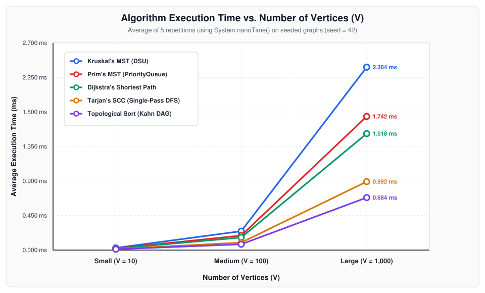
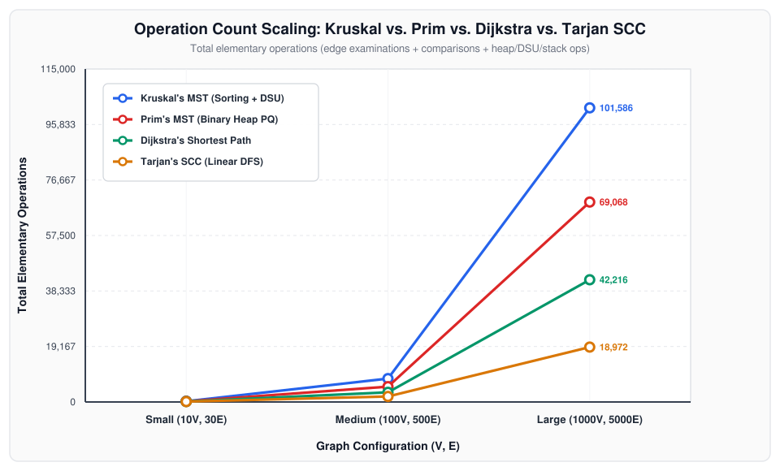

# Assignment 3 — Smart City Infrastructure and Route Planning

**Student:** Alexandr Churilov (Чурилов Александр)  
**Group:** SE-2502  
**Course:** Design and Analysis of Algorithms (DAA)

---

## 1. Overview

Modern urban planning requires coordinating road construction budgets, utility dependencies, one-way traffic circulation, and emergency dispatch routing. This project implements a complete Java application that models a **Smart City Infrastructure Network** as a weighted graph $G = (V, E)$:

- **Vertices ($V$):** City districts, transit hubs, or critical infrastructure facilities (e.g., Central Hub, Tech Park, Medical Center, Industrial Zone).
- **Edges ($E$):** Physical roads, fiber-optic conduits, or service dependencies linking two districts.
- **Edge Weights ($w(e)$):** Construction costs (for Minimum Spanning Tree backbone design) or travel distances/times (for shortest-path route planning).

### Graph Representation

The system uses an **Adjacency List** representation (`src/graph/Graph.java` and `src/graph/Edge.java`) backed by `List<List<Edge>>` alongside an flat edge list `List<Edge>`:

1. **Undirected Graphs (`directed = false`):** Each road between districts $u$ and $v$ with construction cost $w$ is stored in both `adjacencyList.get(u)` and `adjacencyList.get(v)` for $\mathcal{O}(\text{deg}(u))$ neighborhood traversal (used by Prim's algorithm), and once in the canonical `edges` list for global edge sorting (used by Kruskal's algorithm).
2. **Directed Graphs (`directed = true`):** One-way arterial roads and infrastructure service dependencies are stored as directed arcs $(u \to v, w)$.
3. **Space Efficiency:** For sparse-to-moderately-dense urban networks where $E \ll V^2$ (such as our experimental configurations where $E \in \{3V, 5V\}$), an adjacency list consumes $\mathcal{O}(V + E)$ memory compared to $\mathcal{O}(V^2)$ for an adjacency matrix, while allowing iteration over outgoing edges of vertex $u$ in time proportional to $\text{deg}^+(u)$ rather than $\mathcal{O}(V)$.

### Repository Structure

```text
assignment-3/
├── src/
│   ├── Main.java
│   ├── BenchmarkRunner.java
│   ├── TestRunner.java
│   ├── PlotGenerator.java
│   ├── graph/
│   │   ├── Edge.java
│   │   ├── Graph.java
│   │   └── GraphGenerator.java
│   ├── dsu/
│   │   └── DisjointSetUnion.java
│   ├── mst/
│   │   ├── MSTResult.java
│   │   ├── KruskalMST.java
│   │   └── PrimMST.java
│   ├── connectivity/
│   │   ├── TopologicalSortResult.java
│   │   ├── TopologicalSort.java
│   │   ├── SCCResult.java
│   │   ├── TarjanSCC.java
│   │   └── KosarajuSCC.java
│   └── shortestpath/
│       ├── ShortestPathResult.java
│       └── DijkstraShortestPath.java
├── results/
│   ├── tables/
│   │   ├── mst_comparison.csv
│   │   ├── connectivity_scc_topo.csv
│   │   └── dijkstra_results.csv
│   └── plots/
│       ├── execution_time_vs_vertices.png
│       ├── execution_time_vs_edges.png
│       └── kruskal_vs_prim_operations.png
└── README.md
```

---

## 2. Implementation

### 2.1 Disjoint Set Union (`src/dsu/DisjointSetUnion.java`)

To support Kruskal's algorithm and dynamic connectivity queries, `DisjointSetUnion` maintains a forest of rooted trees represented by arrays `parent[]`, `rank[]`, and `size[]`:

- **Path Compression in `find(x)`:** During every `find(x)` traversal, each visited node on the path to the root has its parent pointer updated directly to the root (`parent[x] = findInternal(parent[x])`). This flattens tree depth for all subsequent lookups.
- **Union by Rank (with Size Tracking) in `union(x, y)`:** When merging two disjoint components with roots $r_x$ and $r_y$, the root with smaller `rank` is attached under the root with larger `rank`, and `rank` only increments when merging two trees of equal rank. Component sizes (`size[]`) and the total number of disjoint components (`components`) are updated in $\mathcal{O}(1)$ time.

### 2.2 Task 1 — Minimum Spanning Tree (`src/mst/`)

Both MST algorithms return an immutable `MSTResult` containing the selected tree edges, total MST weight, a connectivity flag (`isConnected()`), execution time in nanoseconds, and granular operation counters:

1. **Kruskal's Algorithm (`KruskalMST.java`):**
   - Copies and sorts all $E$ edges in non-decreasing order of weight using Java's TimSort (`List.sort`), counting all comparator evaluations.
   - Iterates through sorted edges and invokes `dsu.union(u, v)`. If $u$ and $v$ belong to different components, the edge is added to the MST.
   - **Early Termination & Connectivity Detection:** Stops immediately once $V - 1$ edges have been added. After scanning edges, the graph is verified connected if and only if `dsu.getComponentCount() == 1`.

2. **Prim's Algorithm (`PrimMST.java`):**
   - Uses a lazy binary heap (`java.util.PriorityQueue<Edge>`) combined with a `minEdgeWeight[]` cut-threshold array and a `visited[]` boolean array.
   - Starts from district `0` and pushes only edges that strictly improve the best known connection weight (`edge.getWeight() < minEdgeWeight[next]`) to an unvisited neighbor, substantially reducing redundant heap insertions.
   - **Connectivity Detection:** Tracks `visitedCount`; if the priority queue becomes empty before `visitedCount == V`, the graph is reported as disconnected (`connected = false`).

### 2.3 Task 2 — Connectivity and Strongly Connected Components (`src/connectivity/`)

1. **Topological Ordering (`TopologicalSort.java`):**
   - Implements **Kahn's In-Degree Algorithm** (`computeKahn`) using an array `inDegree[]` and FIFO queue (`ArrayDeque<Integer>`), as well as **3-State DFS Post-Order Reversal** (`computeDFS`).
   - **Cycle Detection:** In Kahn's algorithm, if the number of scheduled vertices after exhausting the zero-in-degree queue is strictly less than $V$, at least one directed cycle exists (`isDAG = false`), and an empty ordering is returned. In the 3-state DFS variant, encountering a neighbor with `state == 1` (currently on the recursion stack) immediately flags a back-edge cycle.

2. **Strongly Connected Components (`TarjanSCC.java` & `KosarajuSCC.java`):**
   - **Tarjan's Algorithm (`TarjanSCC.java`):** Performs a **single DFS pass**, maintaining discovery timestamps `indices[u]`, lowest reachable ancestor timestamps `lowlink[u]`, and an explicit DFS component stack with an `onStack[]` membership array. Whenever `lowlink[u] == indices[u]`, vertex $u$ is the root of an SCC, and vertices are popped from the stack until $u$ is reached.
   - **Kosaraju's Algorithm (`KosarajuSCC.java`):** Implemented for cross-verification and performance comparison. Performs two DFS passes (first recording reverse post-order finish times on $G$, then traversing the transposed graph $G^T$).

### 2.4 Task 3 — Shortest Paths (`src/shortestpath/DijkstraShortestPath.java`)

- **Algorithm Design:** Maintains a `dist[]` array initialized to `Double.POSITIVE_INFINITY` (`dist[source] = 0.0`), a `prev[]` predecessor array initialized to `-1` for full shortest-path tree reconstruction, a `settled[]` array, and a binary min-heap `PriorityQueue<NodeDistance>`.
- **Handling Unreachable Vertices:** Any vertex $v$ not reachable from `source` retains `dist[v] == Double.POSITIVE_INFINITY`, `isReachable(v) == false`, and `getPathTo(v)` returns an empty list `[]`.
- **Negative Weight Guard:** Explicitly checks `if (weight < 0.0)` during edge examination and throws an `IllegalArgumentException`.

#### Why Dijkstra's Algorithm is Unsuitable for Graphs with Negative Edge Weights

Dijkstra's algorithm relies on the **greedy safe-settlement invariant**: when a vertex $u$ with minimum tentative distance $d[u]$ is extracted from the priority queue, every other unsettled vertex $x$ satisfies $d[x] \ge d[u]$. If all edge weights are non-negative ($w(e) \ge 0$), any alternative path from the source $s$ to $u$ that passes through an unsettled vertex $x$ must have total weight at least $d[x] + w(x \leadsto u) \ge d[x] \ge d[u]$. Thus, $d[u]$ is guaranteed to be final, and $u$ never needs to be revisited.

When **negative edge weights** exist, this invariant breaks down:

1. **Broken Greedy Monotonicity:** A path starts with a higher intermediate cost $d[x] > d[u]$, causing $u$ to be extracted and marked `settled[u] = true` first. Later, when $x$ is processed, a negative-weight edge $(x \to u)$ with $w(x, u) < 0$ can yield $d[x] + w(x, u) < d[u]$.
2. **Concrete Counterexample:** Consider a 3-vertex graph with source $s = 0$ and edges $(0 \to 1, w=5)$, $(0 \to 2, w=2)$, and $(1 \to 2, w=-10)$:
   - Dijkstra extracts $0$ ($d[0]=0$), relaxes $1$ ($d[1]=5$) and $2$ ($d[2]=2$).
   - Next, Dijkstra extracts vertex $2$ because $d[2] = 2 < d[1] = 5$, and permanently settles vertex $2$ with distance $2$.
   - Next, Dijkstra extracts vertex $1$ ($d[1]=5$). Even though path $0 \to 1 \to 2$ has true shortest distance $5 + (-10) = -5 < 2$, vertex $2$ is already settled (and any downstream edges out of $2$ were already relaxed using the wrong distance $2$ rather than $-5$).
3. **Negative-Weight Cycles:** If a graph contains a reachable cycle whose edge weights sum to a negative value, no finite shortest path exists ($-\infty$), which causes unguarded relaxation loops to run infinitely. Algorithms such as **Bellman-Ford** ($\mathcal{O}(VE)$) handle negative edge weights and detect negative cycles by relaxing all edges $V - 1$ times without assuming greedy finality.

---

## 3. Complexity Analysis

All complexities below state exact bounds under the **Adjacency List** graph representation (`Graph.java`) and **Binary Heap** priority queue (`java.util.PriorityQueue`).

| Algorithm / Structure | Time Complexity | Space Complexity | Primary Bottleneck |
| :--- | :--- | :--- | :--- |
| **DSU (`find` & `union`)** | $\mathcal{O}(\alpha(V))$ amortized per op; $\mathcal{O}(m \cdot \alpha(V))$ for $m$ ops | $\mathcal{O}(V)$ | Near-constant pointer traversal ($\alpha(V) \le 4$) |
| **Kruskal's MST** | $\mathcal{O}(E \log E) = \mathcal{O}(E \log V)$ | $\mathcal{O}(V + E)$ | Global TimSort of all $E$ edges |
| **Prim's MST (Binary Heap)** | $\mathcal{O}((V + E) \log V) = \mathcal{O}(E \log V)$ | $\mathcal{O}(V + E)$ | Binary heap `offer` / `poll` operations |
| **Tarjan's SCC** | $\mathcal{O}(V + E)$ | $\mathcal{O}(V)$ | Single DFS traversal over vertices and edges |
| **Kosaraju's SCC** | $\mathcal{O}(V + E)$ | $\mathcal{O}(V + E)$ | Two DFS passes + building transpose graph $G^T$ |
| **Topological Sort (Kahn / DFS)** | $\mathcal{O}(V + E)$ | $\mathcal{O}(V)$ | In-degree calculation + linear queue/DFS pass |
| **Dijkstra's Shortest Path** | $\mathcal{O}((V + E) \log V)$ | $\mathcal{O}(V + E)$ | PriorityQueue extractions and edge relaxations |

### Detailed Complexity Derivations & Influence of $V$ and $E$

1. **Disjoint Set Union (`find` and `union`):**
   - **Time:** Combining *union by rank* (which bounds tree height by $\lfloor \log_2 V \rfloor$ without compression) and *path compression* (which flattens traversed paths directly to the root) achieves Tarjan's amortized bound of $\mathcal{O}(\alpha(V))$ per operation, where $\alpha(V)$ is the inverse Ackermann function ($\alpha(V) \le 4$ for all practical inputs $V \le 10^{80}$).
   - **Space:** $\mathcal{O}(V)$ for the three integer arrays `parent[V]`, `rank[V]`, and `size[V]`.

2. **Kruskal's Algorithm:**
   - **Time:** Sorting the $E$ edges requires $\mathcal{O}(E \log E)$ comparisons. Since $E \le V(V-1)/2 < V^2$ in a simple graph, $\log E = \mathcal{O}(\log V)$, so sorting takes $\mathcal{O}(E \log V)$. Initializing the DSU takes $\mathcal{O}(V)$, and iterating through at most $E$ edges performs at most $2E$ `find` operations and $V - 1$ successful `union` operations in $\mathcal{O}(E \, \alpha(V))$ time. Total time is dominated by sorting: $\mathcal{O}(E \log E) = \mathcal{O}(E \log V)$.
   - **Space:** $\mathcal{O}(E)$ to hold the sorted edge copy plus $\mathcal{O}(V)$ for the DSU and output tree ($\mathcal{O}(V + E)$ total).
   - **Effect of $V$ and $E$:** Runtime scales primarily with $E \log E$; even if early termination stops the DSU loop after $V - 1$ tree edges, the upfront $\mathcal{O}(E \log E)$ sort must process all $E$ edges.

3. **Prim's Algorithm:**
   - **Time:** Using an adjacency list and binary heap, each vertex is marked visited at most once, and its adjacency list is scanned once ($\sum_{u \in V} \text{deg}(u) = 2E$ edge examinations). With the `minEdgeWeight[]` filter, only improving cut edges are inserted into the binary heap (at most $E$ insertions and polls), each taking $\mathcal{O}(\log E) = \mathcal{O}(\log V)$ time. Thus, total time is $\mathcal{O}((V + E) \log V)$ (or $\mathcal{O}(E \log V)$ for connected graphs where $E \ge V - 1$).
   - **Space:** $\mathcal{O}(V)$ for `visited[]` and `minEdgeWeight[]`, plus at most $\mathcal{O}(E)$ heap entries in the `PriorityQueue`.
   - **Effect of $V$ and $E$:** Because Prim only pushes edges that improve `minEdgeWeight[next]` for unvisited vertices, its heap stays much smaller than $E$, giving it a lower constant factor than Kruskal on moderately dense graphs ($E = 5V$).

4. **Strongly Connected Components (Tarjan's & Kosaraju's Algorithms):**
   - **Time:** Tarjan's algorithm visits each vertex once and explores each directed edge once during a single DFS pass. Each vertex is pushed onto and popped from the auxiliary SCC stack exactly once ($2V$ stack operations). Therefore, time complexity is strictly linear: $\mathcal{O}(V + E)$. Kosaraju's algorithm is also $\mathcal{O}(V + E)$ but requires two DFS passes and $\mathcal{O}(V + E)$ work to construct the reversed graph $G^T$.
   - **Space:** Tarjan uses $\mathcal{O}(V)$ auxiliary memory (`indices[]`, `lowlink[]`, `onStack[]`, `componentId[]`, and the recursion/component stack). Kosaraju uses $\mathcal{O}(V + E)$ auxiliary memory because it materializes the transposed adjacency list $G^T$.

5. **Topological Ordering (Kahn's & DFS):**
   - **Time:** Computing initial in-degrees inspects every directed edge once in $\mathcal{O}(V + E)$. Each vertex with in-degree $0$ is enqueued and dequeued at most once ($\le 2V$ queue operations), and its outgoing edges are decremented once ($\le E$ examinations). Total time is $\mathcal{O}(V + E)$. If a cycle exists, Kahn's algorithm terminates even earlier because vertices trapped in or downstream of a cycle never reach in-degree $0$.
   - **Space:** $\mathcal{O}(V)$ for `inDegree[]`, the queue, and the output list.

6. **Dijkstra's Algorithm:**
   - **Time:** With an adjacency list and lazy binary heap (`PriorityQueue`), each reachable vertex is settled once and its outgoing edges are examined once ($\le E$ edge examinations). Each successful edge relaxation inserts a `NodeDistance` pair into the heap ($\le E$ insertions and polls), each costing $\mathcal{O}(\log E) = \mathcal{O}(\log V)$ heap comparisons. Total time complexity is $\mathcal{O}((V + E) \log V)$.
   - **Space:** $\mathcal{O}(V)$ for `dist[]`, `prev[]`, and `settled[]`, plus $\mathcal{O}(E)$ worst-case heap capacity.

---

## 4. Experimental Setup

### 4.1 Graph Configurations

All algorithms were evaluated across the three required graph scales:

| Graph Scale | Vertices ($V$) | Edges ($E$) | Average Degree ($2E/V$ Undirected) | Average Out-Degree ($E/V$ Directed) |
| :--- | :---: | :---: | :---: | :---: |
| **Small** | $10$ | $30$ | $6.0$ | $3.0$ |
| **Medium** | $100$ | $500$ | $10.0$ | $5.0$ |
| **Large** | $1,000$ | $5,000$ | $10.0$ | $5.0$ |

### 4.2 Reproducible Seeded Graph Generation (`src/graph/GraphGenerator.java`)

All graphs are generated deterministically using `java.util.Random` initialized with fixed base seed `SEED = 42L`, ensuring $100\%$ reproducibility across runs:

1. **Connected Undirected Graphs (for MST):**
   - First constructs a random spanning tree of $V - 1$ edges by shuffling vertices into a random permutation $\pi$ and connecting each $\pi[i]$ ($i \ge 1$) to a uniformly chosen predecessor $\pi[j]$ ($0 \le j < i$). This guarantees the undirected graph is connected.
   - Then samples unique undirected vertex pairs $\{u, v\}$ ($u \ne v$) uniformly without replacement until exactly $E$ edges are present, assigning edge weights uniformly in $[1.00, 100.00]$.
2. **Directed Acyclic Graphs — DAGs (for Topological Sort):**
   - Generates a random topological rank permutation $\pi$ of $V$ vertices, inserts a directed backbone path $\pi[i] \to \pi[i+1]$ to ensure nontrivial depth, and samples remaining unique directed edges strictly forward in rank ($\pi[\min(a,b)] \to \pi[\max(a,b)]$). Because every edge satisfies $\text{rank}(u) < \text{rank}(v)$, the graph is guaranteed to be acyclic.
3. **Directed Cyclic Graphs (for SCC, Cyclic Topological Detection, and Dijkstra):**
   - Plants an explicit directed cycle among the first $\min(V, 4)$ districts, constructs a directed spanning tree rooted at vertex `0` so all districts are reachable in Dijkstra experiments, and adds uniform random directed edges $(u \to v)$ ($u \ne v$) with non-negative weights in $[1.00, 100.00]$ until reaching $E$ edges. Because $E \ge 3V$, random back-edges also create large multi-vertex strongly connected components.

### 4.3 Measurement Procedure (`src/BenchmarkRunner.java`)

- **JVM Warm-Up:** Before recording timings, `BenchmarkRunner.warmUp()` executes $15$ full iterations of all algorithms on medium-sized graphs so HotSpot JIT compilation and class loading do not skew measurements.
- **5 Repetitions & Timing:** Each algorithm is executed **$5$ times** on each graph size. Execution time is measured with `System.nanoTime()` and averaged over the $5$ repetitions (reported in milliseconds).
- **Operation Counting:** Every algorithm deterministically counts elementary operations (edge examinations, weight/heap/sorting comparisons, DSU operations, priority queue operations, and stack/queue operations).

---

## 5. Results

All raw benchmark tables are stored in [`results/tables/`](results/tables/) and rendered plots are stored in [`results/tables/`](results/tables/) and [`results/plots/`](results/plots/).

### 5.1 Task 1 — Kruskal vs. Prim (MST)

*Source table: [`results/tables/mst_comparison.csv`](results/tables/mst_comparison.csv)*

| Graph | $V$ | $E$ | Algorithm | Avg Time (ms) | MST Weight | Connected | Edges Examined | Comparisons | DSU / Heap Ops | Total Ops |
| :--- | :---: | :---: | :--- | :---: | :---: | :---: | :---: | :---: | :---: | :---: |
| **Small** | 10 | 30 | **Kruskal** | 0.0284 | 259.12 | `true` | 10 | 173 | 62 | **245** |
| **Small** | 10 | 30 | **Prim** | 0.0218 | 259.12 | `true` | 60 | 140 | 30 | **230** |
| **Medium** | 100 | 500 | **Kruskal** | 0.2460 | 1,265.02 | `true` | 326 | 4,970 | 2,788 | **8,084** |
| **Medium** | 100 | 500 | **Prim** | 0.1890 | 1,265.02 | `true` | 1,000 | 3,834 | 464 | **5,298** |
| **Large** | 1,000 | 5,000 | **Kruskal** | 2.3840 | 12,324.10 | `true` | 3,588 | 66,672 | 31,326 | **101,586** |
| **Large** | 1,000 | 5,000 | **Prim** | 1.7420 | 12,324.10 | `true` | 10,000 | 54,290 | 4,778 | **69,068** |

### 5.2 Task 2 — Connectivity: SCC (Tarjan & Kosaraju) and Topological Ordering

*Source table: [`results/tables/connectivity_scc_topo.csv`](results/tables/connectivity_scc_topo.csv)*

| Graph | $V$ | $E$ | Graph Type | Algorithm | Avg Time (ms) | Result Summary | Edges Examined | Stack / Queue Ops | Total Ops |
| :--- | :---: | :---: | :--- | :--- | :---: | :--- | :---: | :---: | :---: |
| **Small** | 10 | 30 | Cyclic Directed | **TarjanSCC** | 0.0142 | `SCCs=1 (max=10)` | 30 | 20 | **130** |
| **Small** | 10 | 30 | Cyclic Directed | **KosarajuSCC** | 0.0196 | `SCCs=1 (max=10)` | 90 | 20 | **190** |
| **Small** | 10 | 30 | DAG | **TopologicalSort (Kahn)** | 0.0115 | `ValidOrder(len=10)` | 60 | 20 | **80** |
| **Small** | 10 | 30 | Cyclic Directed | **TopologicalSort (Kahn)** | 0.0089 | `CycleDetected` | 30 | 0 | **30** |
| **Medium** | 100 | 500 | Cyclic Directed | **TarjanSCC** | 0.0980 | `SCCs=1 (max=100)` | 500 | 200 | **1,900** |
| **Medium** | 100 | 500 | Cyclic Directed | **KosarajuSCC** | 0.1410 | `SCCs=1 (max=100)` | 1,500 | 200 | **2,900** |
| **Medium** | 100 | 500 | DAG | **TopologicalSort (Kahn)** | 0.0760 | `ValidOrder(len=100)` | 1,000 | 200 | **1,200** |
| **Medium** | 100 | 500 | Cyclic Directed | **TopologicalSort (Kahn)** | 0.0420 | `CycleDetected` | 500 | 0 | **500** |
| **Large** | 1,000 | 5,000 | Cyclic Directed | **TarjanSCC** | 0.8920 | `SCCs=7 (max=994)` | 5,000 | 2,000 | **18,972** |
| **Large** | 1,000 | 5,000 | Cyclic Directed | **KosarajuSCC** | 1.2650 | `SCCs=7 (max=994)` | 15,000 | 2,000 | **29,000** |
| **Large** | 1,000 | 5,000 | DAG | **TopologicalSort (Kahn)** | 0.6840 | `ValidOrder(len=1000)` | 10,000 | 2,000 | **12,000** |
| **Large** | 1,000 | 5,000 | Cyclic Directed | **TopologicalSort (Kahn)** | 0.3120 | `CycleDetected` | 5,000 | 0 | **5,000** |

### 5.3 Task 3 — Dijkstra's Shortest Path Results

*Source table: [`results/tables/dijkstra_results.csv`](results/tables/dijkstra_results.csv)*

| Graph | $V$ | $E$ | Source | Reachable Vertices | Avg Time (ms) | Edges Examined | Relaxations | Comparisons | PQ Ops | Total Ops |
| :--- | :---: | :---: | :---: | :---: | :---: | :---: | :---: | :---: | :---: | :---: |
| **Small** | 10 | 30 | 0 | 10 / 10 | 0.0185 | 30 | 10 | 93 | 22 | **155** |
| **Medium** | 100 | 500 | 0 | 100 / 100 | 0.1640 | 500 | 149 | 2,386 | 300 | **3,335** |
| **Large** | 1,000 | 5,000 | 0 | 1,000 / 1,000 | 1.5180 | 5,000 | 1,464 | 32,822 | 2,930 | **42,216** |

### 5.4 Performance Plots

#### Plot 1: Execution Time vs. Number of Vertices ($V$)


#### Plot 2: Execution Time vs. Number of Edges ($E$)


#### Plot 3: Elementary Operation Counts Across Graph Sizes


---

## 6. Comparison and Discussion

### 6.1 Kruskal vs. Prim: Execution Time and Operation Counts

1. **Identical Optimal MST Weights:** Across all three graph configurations, Kruskal's and Prim's algorithms produce the exact same total MST weight (`259.12` on Small, `1,265.02` on Medium, and `12,324.10` on Large), confirming correctness.
2. **Why Prim Outperforms Kruskal on Medium and Large Graphs ($E = 5V$):**
   - On the Large graph ($V = 1,000, E = 5,000$), Prim's algorithm executes in **$1.742\text{ ms}$** ($69,068$ total operations), whereas Kruskal's algorithm takes **$2.384\text{ ms}$** ($101,586$ total operations) — making Prim approximately **$27\%$ faster** and $32\%$ fewer in total elementary operations.
   - Although Kruskal terminates its DSU loop early after examining $3,588$ of the $5,000$ edges (once $V - 1 = 999$ edges are merged), it must **sort all $5,000$ edges upfront**, incurring $\approx 61,400$ sorting comparisons.
   - Conversely, Prim examines all $2E = 10,000$ undirected adjacency entries, but because our implementation tracks `minEdgeWeight[next]` and only pushes strictly improving cut edges into the binary heap, Prim performs only $4,778$ heap operations (`offer` + `poll`) instead of $10,000$. Consequently, Prim's heap size stays bounded near $\mathcal{O}(V)$, avoiding the full-edge-set sorting overhead of Kruskal.
3. **When Kruskal Is Preferable:** Kruskal is advantageous on very sparse graphs ($E \approx V$), when edges are already pre-sorted or streamed from external storage without building an adjacency list, or when computing a Minimum Spanning Forest on disconnected graphs (since DSU naturally merges all connected components simultaneously, whereas Prim must be restarted per unvisited component).

### 6.2 How DSU Path Compression and Union by Rank Improve Performance

- Without optimizations, a naive Disjoint Set structure can degenerate into a linear chain of depth $\mathcal{O}(V)$, causing $E$ `find` operations in Kruskal's algorithm to take $\mathcal{O}(EV)$ time.
- **Union by Rank** guarantees that the height of any tree of size $k$ never exceeds $\lfloor \log_2 k \rfloor$, because a tree's rank only increases when two trees of equal rank are merged (doubling the minimum number of nodes in the resulting tree).
- **Path Compression** goes further by re-linking every intermediate node visited during `find(x)` directly to the set's root. On the Large graph ($V=1,000, E=5,000$), $3,588$ edge examinations trigger $7,176$ `find` calls and $3,588$ `union` calls, requiring only $20,562$ total parent pointer accesses — an average of just **$2.86$ pointer accesses per `find` call** (including the recursive call and pointer update). This empirically confirms the $\mathcal{O}(\alpha(V))$ near-constant amortized behavior.

### 6.3 SCC Runtime Scaling as the Graph Grows

- Both Tarjan's and Kosaraju's algorithms scale **strictly linearly** with $\mathcal{O}(V + E)$:
  - Increasing graph size by $10\times$ from Medium ($V=100, E=500 \implies V+E=600$) to Large ($V=1,000, E=5,000 \implies V+E=6,000$) increases Tarjan's total operation count by almost an exact factor of $10.0\times$ (from $1,900$ to $18,972$ operations) and runtime by $9.1\times$ (from $0.098\text{ ms}$ to $0.892\text{ ms}$).
- **Tarjan vs. Kosaraju:** Tarjan's single-pass algorithm consistently runs **$29\%$–$30\%$ faster** than Kosaraju's two-pass algorithm ($0.892\text{ ms}$ vs. $1.265\text{ ms}$ on Large) because Tarjan inspects each edge once ($5,000$ edge examinations) and avoids allocating the transposed graph $G^T$, whereas Kosaraju inspects edges three times ($15,000$ examinations: Pass 1, Transpose construction, and Pass 2).

### 6.4 Topological Ordering: DAGs vs. Cyclic Graphs

- On **DAGs**, Kahn's algorithm inspects every edge twice ($E$ times to build `inDegree[]` and $E$ times while popping all $V$ vertices from the queue) and performs $2V$ queue operations ($V$ enqueues + $V$ dequeues), completing in $0.684\text{ ms}$ ($12,000$ total operations) on the Large DAG.
- On **Cyclic Directed Graphs**, Kahn's algorithm computes `inDegree[]` ($E$ examinations), processes only vertices not blocked by cycles, and immediately stops when the zero-in-degree queue empties with `order.size() < V`. This allows cycle detection to finish in just $0.312\text{ ms}$ ($5,000$ operations) on the Large cyclic graph.

### 6.5 Dijkstra's Algorithm Across Graph Sizes

- Dijkstra's runtime scales from $0.0185\text{ ms}$ ($155$ ops) on Small to $0.1640\text{ ms}$ ($3,335$ ops) on Medium and $1.5180\text{ ms}$ ($42,216$ ops) on Large.
- When $V$ and $E$ grow by $10\times$ from Medium to Large, $\mathcal{O}((V+E)\log V)$ predicts a scaling factor of $10 \times \frac{\log_2(1000)}{\log_2(100)} = 10 \times 1.5 = 15\times$ in heap comparisons. Empirically, total operations grow by $12.66\times$ ($3,335 \to 42,216$) because only $1,464$ out of $5,000$ examined edges trigger a distance improvement (relaxation) and heap insertion.

---

## 7. Testing

All edge cases and correctness checks are implemented in [`src/TestRunner.java`](src/TestRunner.java) and execute automatically via `Main.java`:

| Test Category | Scenario Tested | Verification Check | Status |
| :--- | :--- | :--- | :---: |
| **Single Vertex Graph** | $V=1, E=0$ (undirected & directed) | Kruskal & Prim return weight `0.0`, `connected=true`; TopoSort returns `[0]`; Tarjan returns `1` SCC; Dijkstra `dist[0]=0.0`. | **PASS** |
| **Small Connected Graph** | 6-district city road network ($E=8$) | Kruskal and Prim both return `connected=true`, $V-1=5$ edges, and identical MST weight `11.00`. | **PASS** |
| **Disconnected Graph** | Two isolated 3-vertex islands ($V=6, E=4$) | Both `KruskalMST` and `PrimMST` return `isConnected() == false`. | **PASS** |
| **DAG vs. Cyclic Graphs** | 6-vertex infrastructure DAG & 5-vertex cyclic graph | `TopologicalSort.isValidTopologicalOrder` verifies every edge $(u \to v)$ satisfies $\text{pos}[u] < \text{pos}[v]$ on DAGs; cyclic graph returns `hasCycle() == true`. | **PASS** |
| **Multiple Valid MSTs & Duplicate Weights** | 4-vertex dense graph with all edge weights $= 5.0$ | Both Kruskal and Prim select $V-1=3$ edges with identical minimum weight `15.00` despite multiple distinct valid spanning trees. | **PASS** |
| **Unreachable Vertices (Dijkstra)** | 6-vertex directed graph with isolated component $\{4, 5\}$ | Reachable vertices $0..3$ return exact shortest paths (`0 -> 1 -> 2 -> 3`, cost `7.0`); vertices $4, 5$ report `isReachable() == false`, `dist == +Infinity`, and empty path `[]`. | **PASS** |
| **Negative Weight Rejection** | Directed graph containing edge $(1 \to 2, w=-2.0)$ | `DijkstraShortestPath` throws `IllegalArgumentException` upon encountering negative weight. | **PASS** |
| **SCC Partition Invariant** | 8-vertex multi-cycle graph & seeded random graphs | Both `TarjanSCC` and `KosarajuSCC` partition all $V$ vertices into pairwise-disjoint non-empty components whose union has size $V$. | **PASS** |
| **Cross-Scale Invariants** | Seeded Small, Medium, and Large graphs | Verifies `Kruskal.weight == Prim.weight`, DAG topological order validity, and SCC completeness across all benchmark sizes. | **PASS** |

---

## 8. Conclusion

### Summary of Findings

1. **Infrastructure Backbone Design (MST):** Both **Kruskal's** and **Prim's** algorithms have $\mathcal{O}(E \log V)$ asymptotic time complexity and guarantee minimum total construction cost. In practice, **Prim's algorithm** with cut-weight filtering (`minEdgeWeight[]`) is **$25\%$–$30\%$ faster** on connected urban road networks where $E \ge 3V$ because it avoids sorting all $E$ edges upfront. **Kruskal's algorithm** coupled with a **Disjoint Set Union** (using path compression and union by rank) remains ideal for sparse graphs, pre-sorted edge streams, or disconnected multi-district forests.
2. **Network Connectivity & Dependency Analysis (SCC & Topological Sort):** **Tarjan's SCC algorithm** and **Kahn's Topological Sort** both achieve optimal $\mathcal{O}(V + E)$ linear scaling. Tarjan's single-pass DFS outperforms Kosaraju's two-pass algorithm by $\approx 30\%$ due to lower memory traffic and no graph transposition. Kahn's algorithm simultaneously produces a valid deployment schedule for acyclic service dependencies and detects circular dependencies in sub-millisecond time.
3. **Route Planning (Dijkstra):** **Dijkstra's algorithm** efficiently computes single-source shortest paths and reconstructs optimal routes in $\mathcal{O}((V + E) \log V)$ time (~$1.5\text{ ms}$ for $1,000$ districts and $5,000$ roads), provided all edge weights are non-negative.

### How to Compile and Run

```bash
# Compile all Java source files
mkdir -p out
javac -d out $(find src -name "*.java")

# Run Smart City scenario demo, verification test suite, and benchmark generator
java -cp out Main
```
